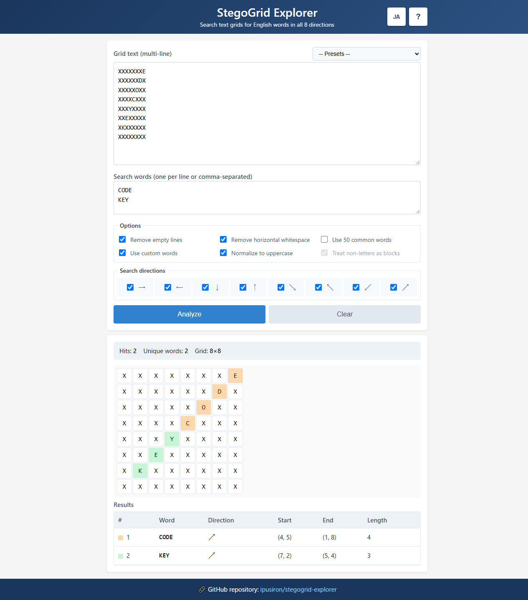

# StegoGrid Explorer - Text-grid word search tool

[日本語](README.md) | English


[](https://ipusiron.github.io/stegogrid-explorer/)

**Day104 - Security Tools Made with Generative AI 200**

StegoGrid Explorer treats multi-line text as a character grid and searches for ASCII English words in eight horizontal, vertical, and diagonal directions. It is a learning and investigation aid for inspecting character paths and coordinates.

## 🌐 Demo

Open [StegoGrid Explorer on GitHub Pages](https://ipusiron.github.io/stegogrid-explorer/) directly in a browser.

## 📸 Screenshot

> 
> *Inspecting diagonal words and coordinates in a deterministic preset*

## ✨ Features

- Search in eight directions: →, ←, ↓, ↑, ↘, ↖, ↙, and ↗
- Search a built-in list of 50 common words or up to 500 custom words
- Show the word, direction, start, end, length, and highlighted path
- Preserve case for case-sensitive matching when uppercase normalization is off
- Treat every non-ASCII-letter code point as a blocking cell
- Load three deterministic teaching presets
- Use the complete interface in Japanese or English
- Run locally without external libraries or network requests

## 🎯 Use cases

### Uses specific to this tool

- **Compare all eight reading paths:** Place `CODE` horizontally and diagonally, then compare its direction and coordinates.
- **Experiment with case:** Turn normalization off and compare `Code` with `CODE` to see how matching rules affect results.
- **Observe chance matches:** Toggle the common list to see why short three-letter words often appear unintentionally.
- **Inspect block boundaries:** Insert spaces, symbols, or emoji between letters and verify that a word cannot cross them.

### General uses

- Learn the basics of word-grid steganography
- Check vertical, diagonal, and reverse-reading layouts
- Assist with a candidate-word check in a CTF or puzzle
- Create and verify word-search teaching material

## 🧩 Processing rules

- Search words must contain 3–100 ASCII letters.
- With uppercase normalization on, both the grid and dictionary are converted to uppercase. With it off, matching is case-sensitive.
- Whitespace removal keeps line boundaries and removes horizontal whitespace such as tabs, regular spaces, and full-width spaces.
- Non-ASCII letters, digits, symbols, and emoji are blocking cells. Unicode input is counted by code point rather than UTF-16 code unit.
- A palindrome found on the same cells in reverse directions is reported once.

## 📖 Usage

1. Enter or paste multi-line text.
2. Choose search words, preprocessing rules, and directions.
3. Select **Analyze** or press Ctrl+Enter.
4. Inspect the highlighted grid and result table.

A preset disables the common list and enables its custom words, so only the documented teaching targets are searched. Result rows can be selected with a pointer or with Enter/Space after moving focus with Tab.

## ⚙️ Limits

The following hard limits prevent long-running browser work. Rendering and searching do not start when an input exceeds a limit.

| Item | Limit |
|---|---:|
| Grid | 20,000 cells |
| Rows | 500 |
| Columns | 500 |
| Custom words | 500 |
| Word length | 100 characters |
| Displayed results | 5,000 |

## ⚠️ Limitations

A match only shows that the configured character sequence exists on that path. It does not prove a hidden message, authorial intent, or the presence of steganography. Short common words are particularly likely to match by chance, so interpret results with context and independent evidence.

## 🔧 Technical notes

- Plain HTML, CSS, and JavaScript
- Client-side only; no external communication
- DOM-independent search core tested with Node's built-in test runner
- User input rendered with `textContent` and a restrictive Content Security Policy
- Compatible with HTTP(S) and `file://`

## 📁 Directory structure

```text
stegogrid-explorer/
├── index.html          # Main page
├── script.js           # UI, localization, and rendering
├── stegogrid-core.js   # DOM-independent search core
├── style.css           # Responsive styles
├── README.md           # Japanese documentation
├── README.en.md        # This document
├── package.json        # Test command
├── test/
│   └── core.test.js    # Core regression tests
├── .github/workflows/
│   └── test.yml        # GitHub Actions workflow
├── assets/
│   ├── screenshot.png
│   └── en/
│       └── screenshot.png
├── CLAUDE.md
└── LICENSE
```

## 📄 License

See [LICENSE](LICENSE) for the source-code license.

## 🛠️ About this tool

This tool is part of the “Security Tools Made with Generative AI 200” project, an initiative to build and publish security-related tools over 100 days with assistance from AI.

See the [project page](https://akademeia.info/?page_id=44607) for details and other tools.
