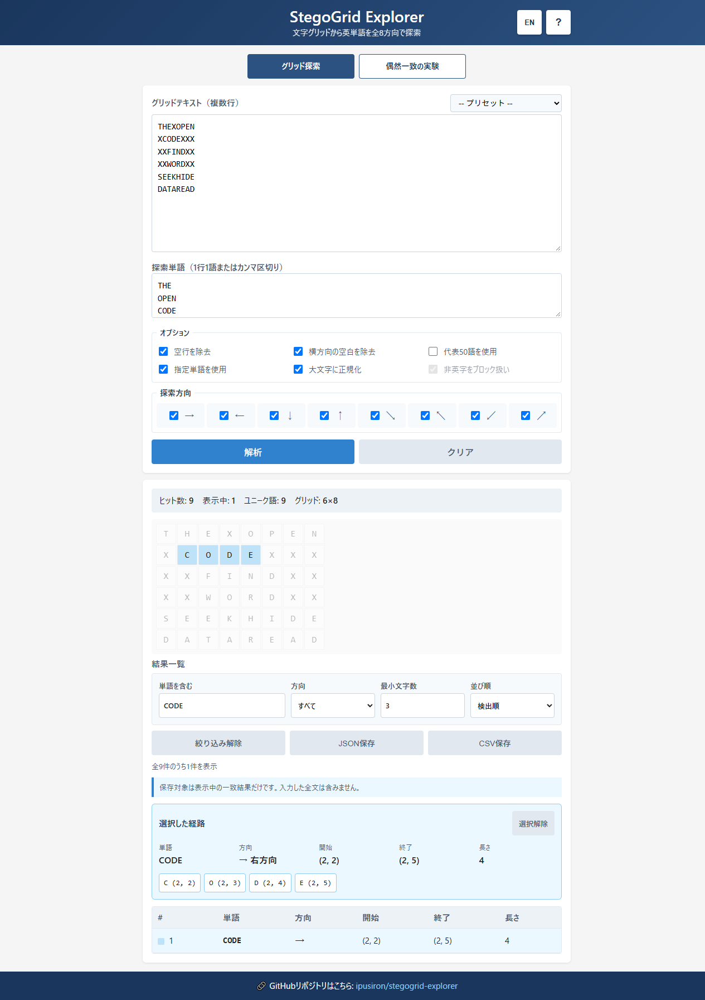
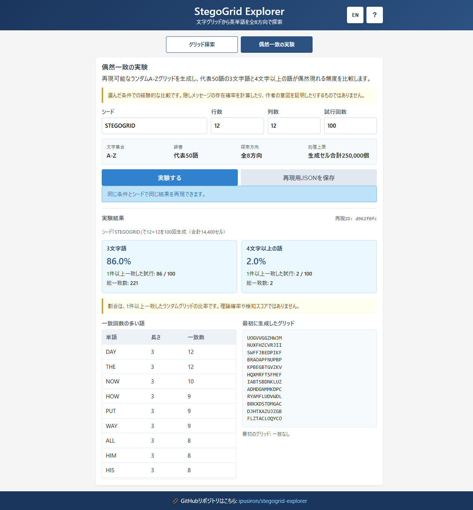

<!--
---
id: day104
slug: stegogrid-explorer

title: "StegoGrid Explorer"

subtitle_ja: "縦・横・斜め・逆方向から隠し単語を探索するグリッド解析ツール"
subtitle_en: "Explore hidden words in text grids from all directions"

description_ja: "複数行テキストを文字グリッドとして扱い、縦・横・斜め・逆方向の全8方向から英単語を探索・可視化するステガノグラフィー解析支援ツール。"
description_en: "A grid-based word exploration tool that scans text in all eight directions to uncover hidden words, designed for steganography and cipher analysis."

category_ja:
  - ワードパズル
  - ステガノグラフィー
category_en:
  - Word Puzzle
  - steganography

difficulty: 1

tags:
  - steganography
  - word-search
  - cipher
  - grid
  - visualization

repo_url: "https://github.com/ipusiron/stegogrid-explorer"
demo_url: "https://ipusiron.github.io/stegogrid-explorer/"

hub: true
---
!-->

# StegoGrid Explorer - 文字グリッド単語探索ツール


[](https://ipusiron.github.io/stegogrid-explorer/)

**Day104 - 生成AIで作るセキュリティツール200**

StegoGrid Explorerは、複数行テキストを文字グリッドとして扱い、縦・横・斜め・逆方向を含む全8方向からASCII英単語を探索・可視化するWebツールです。文字列の配置と座標を確認するための学習・調査補助に使えます。

---

## 🌐 デモページ

👉 **[https://ipusiron.github.io/stegogrid-explorer/](https://ipusiron.github.io/stegogrid-explorer/)**

ブラウザーで直接お試しいただけます。

---

## 📸 スクリーンショット

> 
> *一致結果の絞り込み、選択経路の文字と座標を確認*

> 
> *3文字語と4文字以上の語について、偶然一致した試行の比率と総一致数を比較*

---

## ✨ できること

- 複数行テキストを文字グリッドとして解析
- 以下8方向すべてから英単語を探索
  - 横方向：右（→）、左（←）
  - 縦方向：下（↓）、上（↑）
  - 斜め方向：右下（↘）、左上（↖）、右上（↗）、左下（↙）
- 50語の代表的な英単語（3文字以上）を検索
- ユーザーが指定した任意の単語リストにも対応
- 見つかった単語を以下の形式で可視化
  - グリッド上でのハイライト表示
  - 単語・方向・開始位置・終了位置の一覧表示
  - 複数の単語が見つかった場合は色分けして表示
- 空白や記号をまたいだ一致を防止（非ASCII英字は探索ブロック扱い）
- 大文字への正規化をOFFにした場合は大小文字を区別
- 3種類の再現可能な教材プリセット
- 結果を単語・方向・最小文字数で絞り込み、検出順・単語順・長い順・方向順に並べ替え
- 選択した結果について、経路上の各文字と1始まりの座標を表示
- 表示中の結果だけをJSONまたはCSVとして保存
- シード付きランダムグリッドで、3文字語と4文字以上の語の偶然一致頻度を比較
- 同じシード・行数・列数・試行回数から同じ実験結果を再現
- 実験条件、集計、最初のグリッドを再現用JSONとして保存

---

## 🎯 ユースケース

### このツールならではの使い方

- **8方向の読み筋を比較する**：`CODE`を右向きと右上向きに置き、方向・開始座標・終了座標がどう変わるか確認する。
- **大小文字の扱いを実験する**：正規化OFFで`Code`と`CODE`を別の文字列として比較し、検索条件が結果へ与える影響を学ぶ。
- **偶然一致を観察する**：代表50語をON／OFFにして、3文字の短い語が意図せず見つかりやすいことを確認する。
- **語長による偶然一致の差を比較する**：偶然一致の実験で、同じランダムグリッド群における3文字語と4文字以上の語の一致頻度を比べる。標準条件のシード`STEGOGRID`、12×12、100試行では、3文字語は86試行、4文字以上は2試行で1件以上一致する。
- **ブロック境界を確かめる**：英字の間へ空白・記号・絵文字を置き、単語が非英字をまたがないことと座標の変化を確認する。

### 一般的な使い方

- ステガノグラフィーやワードグリッドの入門学習
- 縦読み・斜め読み・逆読みの配置確認
- CTFやパズルで、候補語が指定経路に存在するかを調べる補助
- 単語探し教材の作成と答え合わせ

---

## 🧩 処理規則

- 非英字（空白・記号など）をブロック扱い
- 単語は3〜100文字のASCII英字だけを対象とする
- 行長が不揃いなテキストでも解析可能
- 絵文字や結合文字を含む非ASCII文字は、UTF-16コード単位ではなくコードポイント単位で1ブロックとして数える
- 空白除去では行境界を維持し、タブ・半角スペース・全角スペースなどの横方向の空白を除去
- 同じ回文が同じセル列で逆方向にも一致する場合は1件にまとめる
- 偶然一致の実験はA-Zを一様に生成し、代表50語を全8方向で探索する
- 乱数方式は`fnv1a-mulberry32-v1`として固定し、同じ条件とシードで同じ結果を再現する
- 外部ライブラリ不使用のシンプル構成

---

## 📖 使い方

### グリッド探索

1. 「グリッド探索」タブで、テキストエリアに複数行の文字列を貼り付ける
2. 必要に応じて探索単語や方向を設定
3. 「解析」をクリック、またはCtrl+Enterを押す
4. グリッドと結果一覧を確認
5. 必要に応じて結果を絞り込み、行を選択して経路の文字と座標を確認
6. 表示中の結果をJSONまたはCSVで保存

プリセットを選ぶと代表50語はOFF、指定単語はONになり、説明に記載した教材語だけを探索します。結果行はクリックのほか、Tabで移動してEnterまたはSpaceでも選択できます。

絞り込み後は、盤面の強調、表示件数、結果一覧、選択経路が同じ結果集合に連動します。JSON／CSVに含まれるのは表示中の一致結果、方向、1始まりの座標、経路などです。入力した全文は含みません。CSVは表計算ソフトで数式として解釈される先頭記号を無害化します。

### 偶然一致の実験

1. 「偶然一致の実験」タブを開く
2. シード、行数、列数、試行回数を指定する
3. 「実験する」を押し、3文字語と4文字以上の語を比較する
4. 一致回数の多い語と最初に生成されたグリッドを確認する
5. 必要なら再現用JSONを保存する

表示する割合は、指定回数のうち1件以上一致したランダムグリッドの比率です。理論確率、検知率、隠しメッセージの存在確率ではありません。

---

## ⚙️ 処理上限

ブラウザーの長時間占有を避けるため、次のハード上限を設けています。超過時は描画・探索を開始しません。

| 項目 | 上限 |
|---|---:|
| グリッド | 20,000セル |
| 行数 | 500行 |
| 列数 | 500列 |
| 指定単語 | 500語 |
| 1語の長さ | 100文字 |
| 表示結果 | 5,000件 |
| 実験の行数・列数 | 各3〜30 |
| 実験の試行回数 | 1〜500回 |
| 実験の生成セル合計 | 250,000個 |

---

## ⚠️ 結果の限界

一致結果は、選択した条件で文字列がその経路に存在することだけを示します。隠しメッセージ、作者の意図、ステガノグラフィーの存在を証明するものではありません。特に3文字程度の短い一般語は偶然一致しやすいため、周辺の文脈や別の根拠と合わせて判断してください。

偶然一致の実験も、A-Zの一様乱数、代表50語、全8方向という限定条件の経験的な比較です。自然言語の文字分布や理論確率をモデル化せず、実在の文章や暗号文に一般化できる確率を算出しません。

---

## 📚 代表50語リスト

「代表50語を使用」オプションを有効にすると、以下の英単語が自動的に検索対象となります。

| 3文字 | | | | | | | | | |
|-------|-----|-----|-----|-----|-----|-----|-----|-----|-----|
| THE | AND | FOR | ARE | BUT | NOT | YOU | ALL | CAN | HAD |
| HER | WAS | ONE | OUR | OUT | DAY | GET | HAS | HIM | HIS |
| HOW | MAN | NEW | NOW | OLD | SEE | WAY | WHO | BOY | DID |
| ITS | LET | PUT | SAY | SHE | TOO | USE | KEY | | |

| 4文字 | | | | | | | | | |
|-------|------|------|------|------|------|------|------|------|------|
| CODE | WORD | FIND | HIDE | TEXT | GRID | LINE | OPEN | READ | SEEK |
| TRUE | DATA | | | | | | | | |

---

## 🔧 技術仕様

- HTML / CSS / JavaScriptのみで実装
- クライアントサイド完結（外部通信なし）
- 結果ファイルの生成と保存もブラウザー内で完結
- 偶然一致の実験も外部送信せず、同期処理をハード上限内で実行
- GitHub Pagesで動作
- ユーザー入力は`textContent`で描画し、CSPを設定
- HTTPと`file://`の両方で利用可能

---

## 📁 ディレクトリー構造

```
stegogrid-explorer/
├── index.html          # メインHTMLファイル
├── script.js           # UI・日英切り替え・描画処理
├── stegogrid-core.js   # DOMに依存しないグリッド探索コア
├── style.css           # スタイルシート
├── README.md           # 本ドキュメント
├── README.en.md        # 英語版ドキュメント
├── package.json        # テスト実行設定
├── test/               # Node標準テスト
│   ├── core.test.js    # 探索・絞り込み・出力のテスト
│   └── docs-ui.test.js # UI・文書・セキュリティの回帰テスト
├── .github/workflows/  # GitHub Actions
│   └── test.yml
├── LICENSE             # ライセンスファイル
├── CLAUDE.md           # Claude Code用プロジェクト情報
├── .gitignore          # Git除外設定
└── assets/             # 画像リソース
    ├── screenshot.png  # 日本語画面のスクリーンショット
    ├── screenshot2.png # 日本語・偶然一致実験のスクリーンショット
    └── en/
        ├── screenshot.png  # 英語・グリッド探索のスクリーンショット
        └── screenshot2.png # 英語・偶然一致実験のスクリーンショット
```

---

## 📄 ライセンス

- ソースコードのライセンスは `LICENSE` ファイルを参照してください。

---

## 🛠️ このツールについて

本ツールは、「生成AIで作るセキュリティツール200」プロジェクトの一環として開発されました。
このプロジェクトでは、AIの支援を活用しながら、セキュリティに関連するさまざまなツールを100日間にわたり制作・公開していく取り組みを行っています。

プロジェクトの詳細や他のツールについては、以下のページをご覧ください。

🔗 [https://akademeia.info/?page_id=44607](https://akademeia.info/?page_id=44607)
